# How Catalog Infinite Scroll behaves

## Where it attaches

The module attaches itself in three places, plus anywhere you put the [widget](widget.md). It does this through layout XML, and only when Enable Infinite Scroll is Yes.

### Category pages

The layout handle `catalog_category_view` adds the module's block after the category product list. Open any category with more than one page of products and it just works.

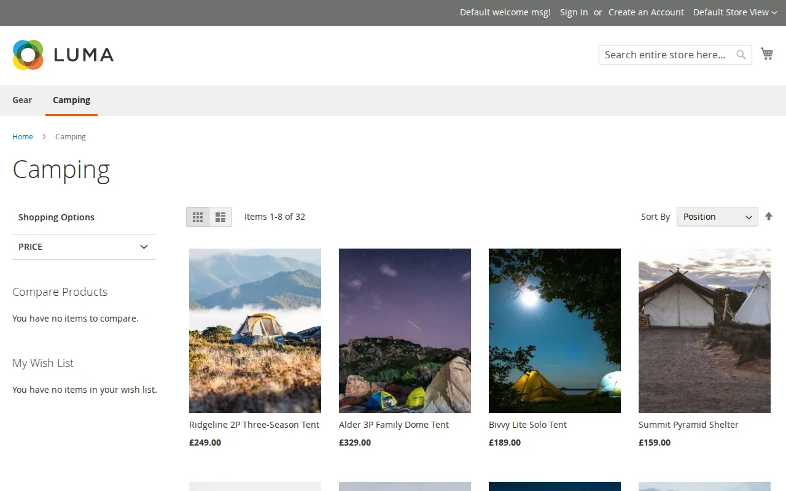

*The Camping category at the start. Eight of 32 products show; the module has hidden the pager.*

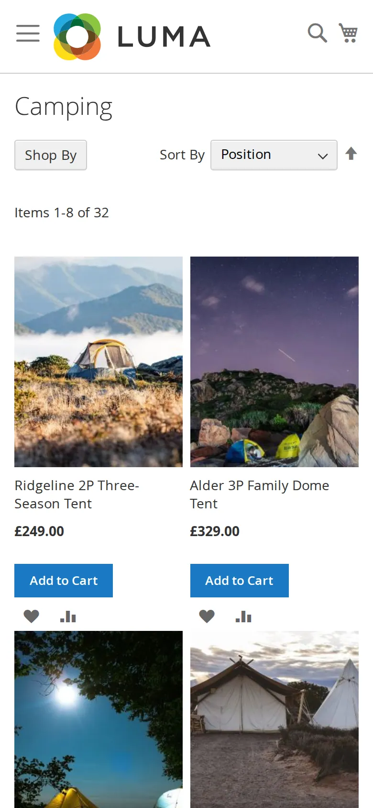

*At 390 px wide the list is two columns and the module uses View More.*

### Search results

The handles `catalogsearch_result_index` (quick search) and `catalogsearch_advanced_result` (advanced search) add the same block after the results list.

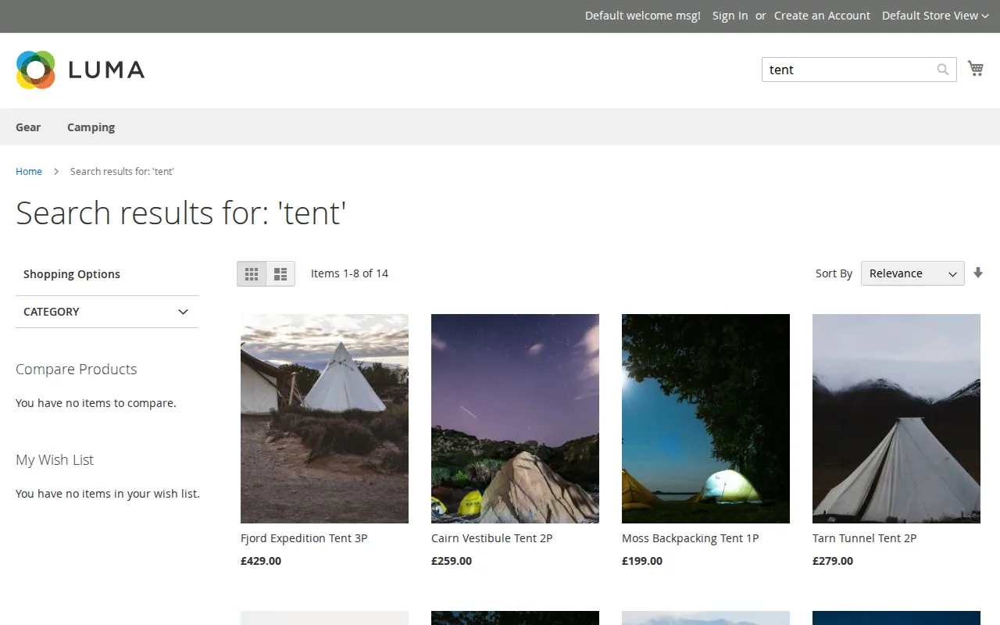

*A search for "tent": Items 1-8 of 14, scrolling loads the rest.*

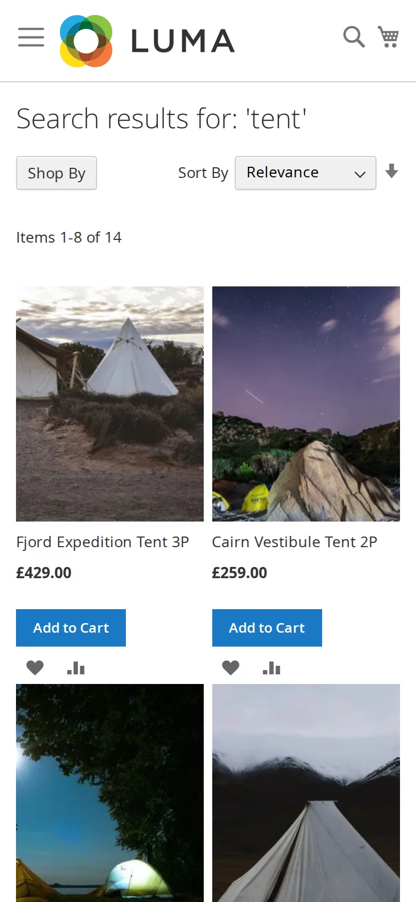

*The same search on a phone.*

### Several lists on one page

Magento starts one component instance for every element that matches the List Container Selector. Each list gets its own loading block, its own View More button and its own state. A category grid and a Page Builder product list on one page scroll independently.

### Layered navigation (AJAX filters)

Filters and some "load more filters" extensions replace the list without reloading the page. The module watches the main column with a `MutationObserver` (debounced by 150 ms). When it sees the list replaced, it tears down the old instance, removes its loading block and classes, and starts again on the new list, provided the next link is present. Added in 2.0.1.

## Auto scroll or View More

| Screen width | Load On Scroll = Yes | Load On Scroll = No |
|---|---|---|
| 768 px and wider | The next page loads as the shopper nears the bottom | A **View More** button |
| Under 768 px | A **View More** button | A **View More** button |

Below 768 px auto loading is always off, because on a phone a page that grows under your finger is hard to use. The rule reacts live, so resizing a window or rotating a tablet switches modes without a reload. The button hides itself once the last page has loaded.

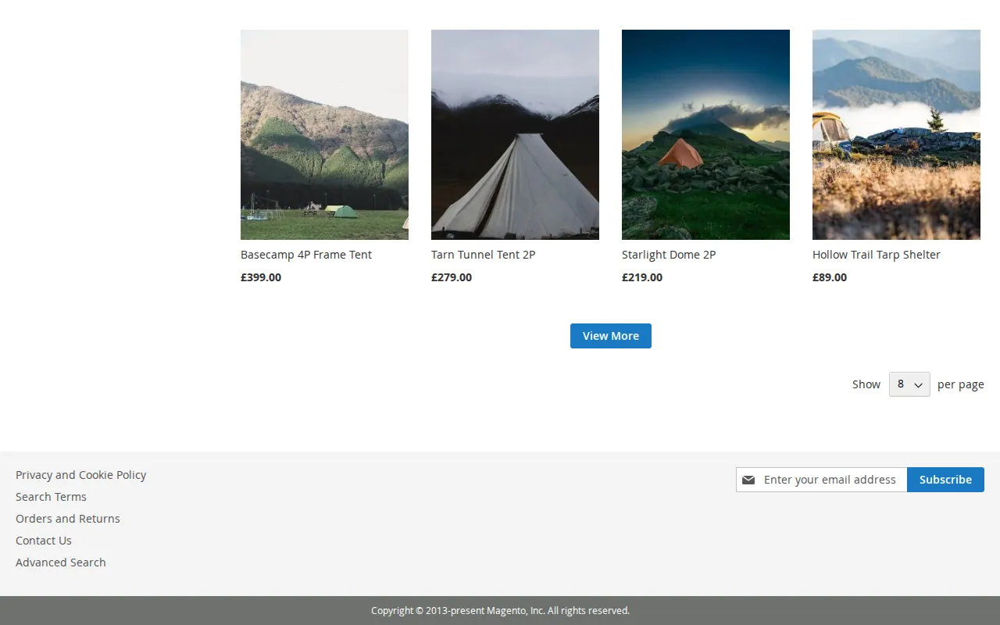

*Load On Scroll is No, so the View More button sits under the list.*

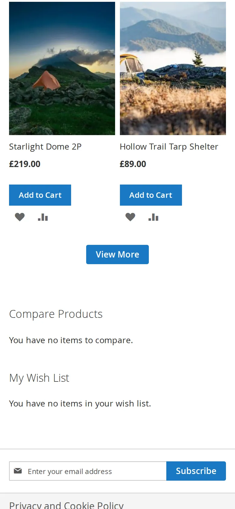

*On a phone the button is the only way to load more.*

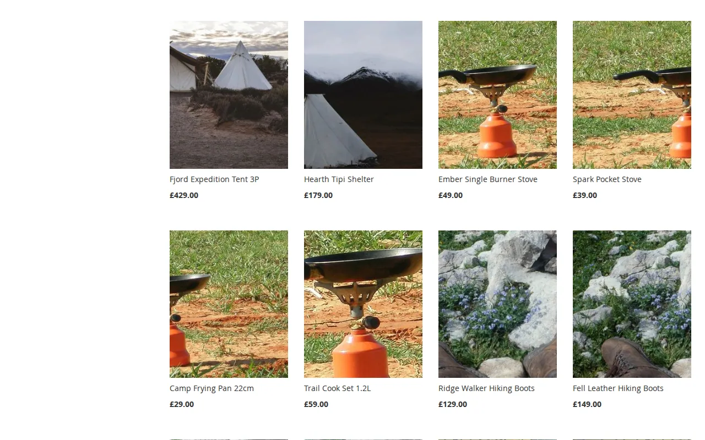

*After two presses more products have loaded in place and the button moved down.*

## The address bar follows the page

With Update Browser URL on, each time a page is appended the address becomes that page's real URL, for example `/camping.html?p=3`, other query parameters kept. The module **replaces** the current history entry rather than adding one, so you are never forced to press Back once per loaded page. The address names the last page loaded, which makes it safe to share, refresh or bookmark.

The module sets the scroll library's own history handling to off and does its own URL handling instead.

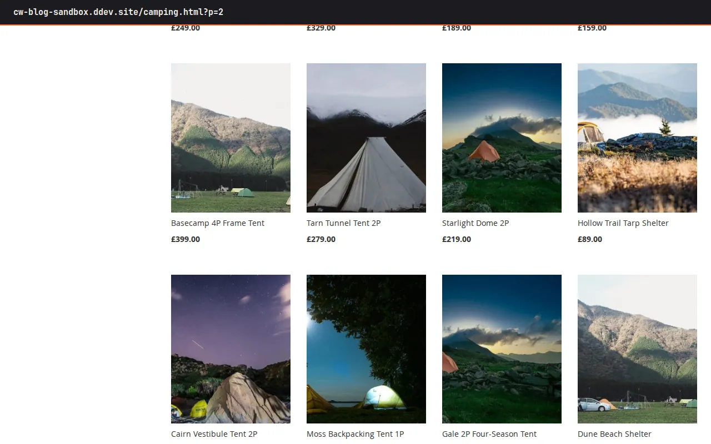

*The URL has moved to ?p=2 as the second page appeared.*

## Back and Forward

When a shopper opens a product from the list and presses Back, the module fetches the earlier pages again, puts them back in order and returns the scroll position, loading no page twice. The state is kept per browser tab in `sessionStorage`, only when Update Browser URL is on. If a fetch fails, only the page named in the URL is shown.

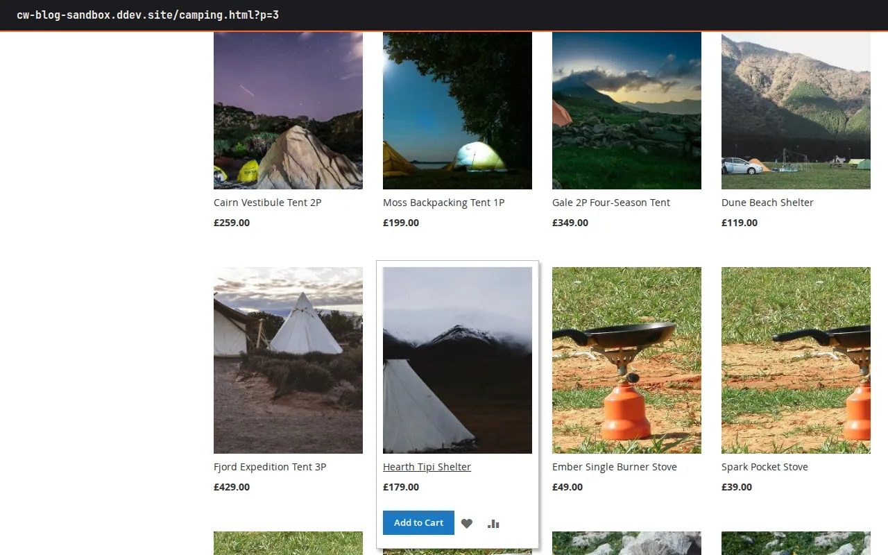

*After Back, the list is rebuilt at ?p=3 and the scroll position returns to the product the shopper left.*

The same works from the last page. Open a product after the final page has loaded, press Back, and every earlier page comes back with the scroll position and the end message. Back never loads an extra page after the restore: auto-load is held off while the list settles.

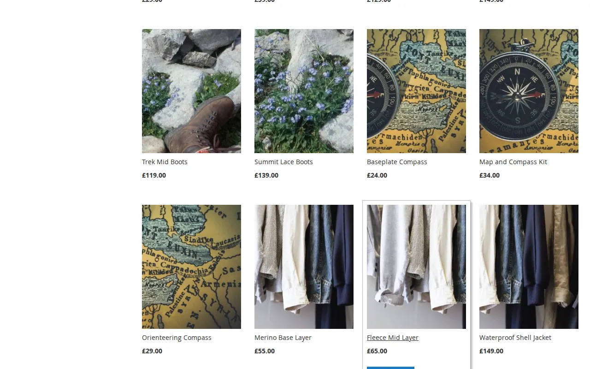

*Back from the last page: the earlier pages return and the scroll position goes back to the product the shopper left.*

## The end of the list

While a page is being fetched, with Show End Status on, a row of animated dots shows below the list. When no next link remains the module reaches the last page. It shows the End Status Text where the dots were, and hides View More. The same text is announced to screen readers through a polite live region, as are the loading and error messages.

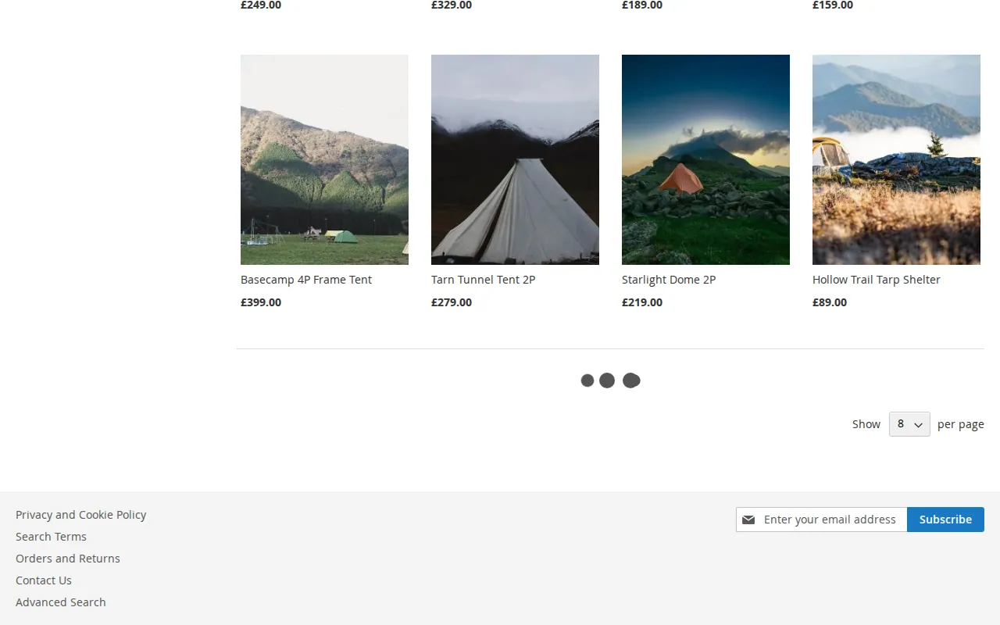

*The loading dots while page 2 is being fetched.*

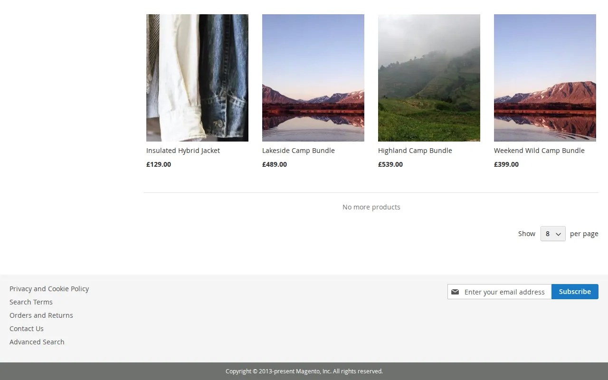

*The end of the list at 1280 px: No more products.*

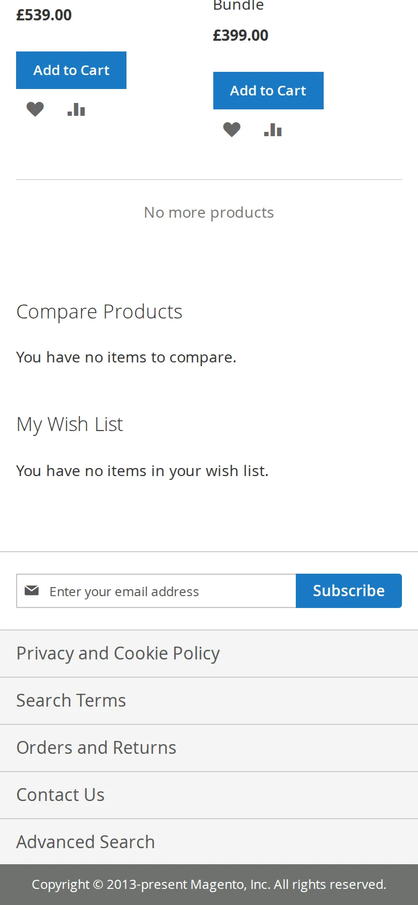

*The same message on a phone.*

## What the module does not do

It does not load pages to fill a tall screen on its own (prefill is off). Pages load only when the shopper scrolls to the threshold or presses View More.
