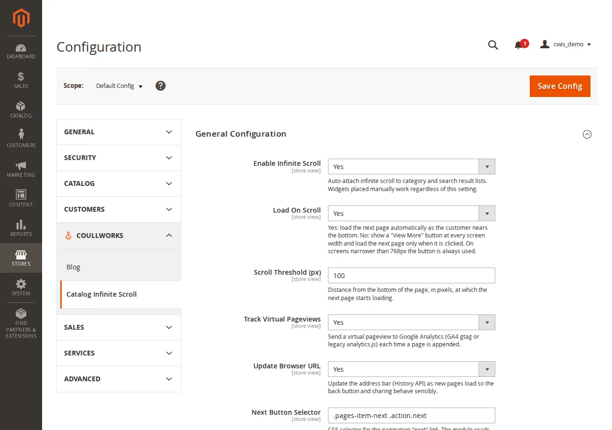
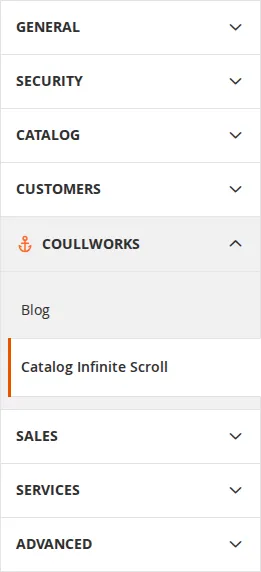
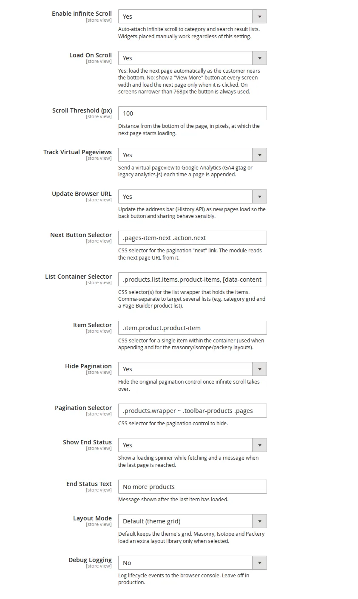
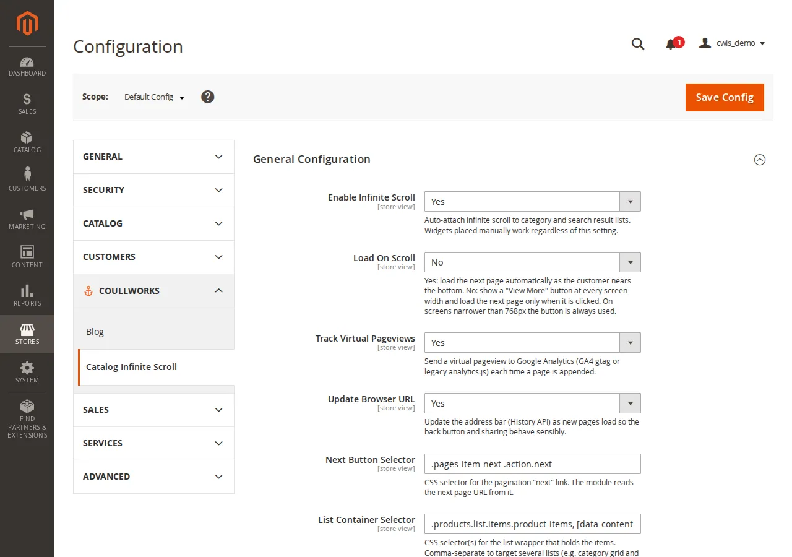
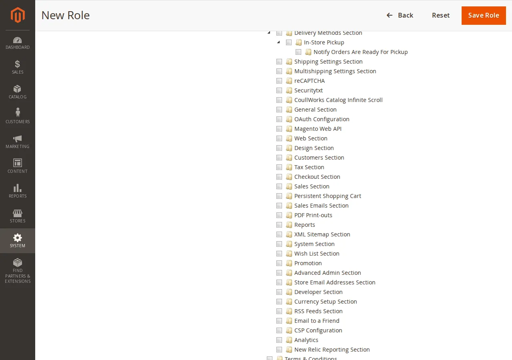

# Configure Catalog Infinite Scroll for Magento 2

All settings live in one place: **Stores, Configuration, CoullWorks, Catalog Infinite Scroll, General Configuration**. Every field can be set at **Default Config**, **website** and **store view** scope, so each store view can behave differently. See [per store view settings](store-views.md). Save with **Save Config** and refresh the Configuration cache.

## The CoullWorks tab

*The CoullWorks tab is open at the left, with Catalog Infinite Scroll selected.*

Open **Stores, Configuration**. In the left column, the **CoullWorks** tab (with the anchor logo) holds the settings of every CoullWorks module. Catalog Infinite Scroll is listed under it. The logo comes from a small admin stylesheet loaded on every admin page.

*The CoullWorks tab with its logo and the Catalog Infinite Scroll entry.*

## The Catalog Infinite Scroll section

Click **Catalog Infinite Scroll** under the CoullWorks tab. It is one section with one group, and it is visible at default, website and store view scope.

*The section opens straight onto General Configuration. Use the **Scope** switcher at the top left to change store view.*

## General Configuration

The only group in the section. It holds all 14 settings below, in this order. Fields marked as depending on another field appear only when that field is Yes.

*All fields on one screen: toggles first, then the three selectors, then pagination, end status, layout mode and debug.*

### Enable Infinite Scroll

*Enable Infinite Scroll is the first field on the screen, with its comment.*

- **Where:** first field in General Configuration.
- **Values:** Yes or No. **Default:** Yes. **Scope:** default, website and store view.
- **Storefront effect:** Yes attaches infinite scroll to category pages, quick search results and advanced search results automatically. No removes it from those pages and the normal pager returns. Widgets you place by hand still work when this is No.
- **Change it when:** you want to switch the module off for one store view, or while you debug a theme conflict.

*Enable Infinite Scroll set to Yes, with the comment that widgets work regardless.*

### Load On Scroll

- **Values:** Yes or No. **Default:** Yes. **Scope:** default, website and store view.
- **Storefront effect:** Yes loads the next page automatically as the shopper nears the bottom, on screens 768 px wide and over. No shows a **View More** button at every screen width and loads the next page only when it is clicked. Screens narrower than 768 px always use the button.
- **Change it when:** you want the shopper to choose when to load more, for example to keep the footer reachable.

*Load On Scroll set to Yes. Its comment spells out the 768 px rule.*

### Scroll Threshold (px)

- **Values:** a whole number of pixels, zero or more. **Default:** 100. **Scope:** default, website and store view.
- **Storefront effect:** the distance from the bottom of the page at which the next page starts loading. A larger number loads earlier.
- **Shown only when** Load On Scroll is Yes. When Load On Scroll is No the field is hidden, because nothing scrolls to load.
- **Change it when:** loading feels late (raise it, for example 400) or you want it to wait until the shopper is almost at the end (lower it).

*The threshold at its default of 100.*

*With Load On Scroll set to No, Scroll Threshold disappears from the list of fields.*

### Track Virtual Pageviews

- **Values:** Yes or No. **Default:** Yes. **Scope:** default, website and store view.
- **Storefront effect:** each time a page is appended it sends a `page_view` to GA4 (`gtag`), or a pageview to legacy `analytics.js`. If neither is on the page, nothing is sent. Details are in the [reference](reference.md#analytics-and-virtual-pageviews).
- **Change it when:** you count scrolled pages another way and do not want double counting.

*Track Virtual Pageviews set to Yes.*

### Update Browser URL

- **Values:** Yes or No. **Default:** Yes. **Scope:** default, website and store view.
- **Storefront effect:** as each page loads, the address bar changes to that page, for example `/camping.html?p=3`. No history entry is added. It also lets Back from a product page restore the list. See [How it behaves](behaviour.md#the-address-bar-follows-the-page).
- **Change it when:** you prefer the address to stay on the first page. Turning it off also turns off Back restoration.

*Update Browser URL set to Yes.*

### Next Button Selector

- **Values:** a CSS selector. Required. **Default:** `.pages-item-next .action.next` (Luma's next-page link). **Scope:** default, website and store view.
- **Storefront effect:** the module reads the URL of the next page from this link, and stops when the link is no longer on the page. If the selector finds nothing, the module stays idle.
- **Change it when:** your theme's pager uses a different class on the next link.

*The default Luma selector for the next-page link.*

### List Container Selector

- **Values:** a CSS selector, or several separated by commas. Required. **Default:** `.products.list.items.product-items, [data-content-type="products"] .products.list.items.product-items` (the category grid and Page Builder product lists). **Scope:** default, website and store view.
- **Storefront effect:** the element that wraps the products. One instance starts for every element that matches, so a page with a category grid and a Page Builder list scrolls both independently.
- **Change it when:** your theme wraps the list in different markup.

*Two selectors, comma separated, so category grids and Page Builder lists are both covered.*

### Item Selector

- **Values:** a CSS selector. Required. **Default:** `.item.product.product-item`. **Scope:** default, website and store view.
- **Storefront effect:** one product tile. It is the element appended from each new page, and the column width for the Masonry, Isotope and Packery layouts.
- **Change it when:** your theme's product tile has a different class.

*The default product tile selector.*

### Hide Pagination

*Hide Pagination and the Pagination Selector that depends on it, in the full group.*

- **Values:** Yes or No. **Default:** Yes. **Scope:** default, website and store view.
- **Storefront effect:** Yes hides the original numbered pager once infinite scroll starts. No leaves it visible, which can be handy for shoppers who want to jump to a page.
- **Change it when:** you want to keep the pager as well.

*Hide Pagination set to Yes.*

### Pagination Selector

- **Values:** a CSS selector. **Default:** `.products.wrapper ~ .toolbar-products .pages`. **Scope:** default, website and store view.
- **Shown only when** Hide Pagination is Yes.
- **Storefront effect:** the element to hide. Leave Luma's default unless your pager sits elsewhere.

*The selector for the pager that gets hidden.*

### Show End Status

- **Values:** Yes or No. **Default:** Yes. **Scope:** default, website and store view.
- **Storefront effect:** shows a loading animation (dots) while a page is fetching, and the End Status Text when the last page is reached. If a request fails, an error message shows instead. The messages are also announced through a polite live region. No leaves the status block out.
- **Change it when:** you want a silent list.

*Show End Status set to Yes.*

### End Status Text

- **Values:** free text. **Default:** No more products. **Scope:** default, website and store view.
- **Shown only when** Show End Status is Yes.
- **Storefront effect:** the same message is used for the end of the list and for a failed request. Translate it per store view.

*The default end message.*

### Layout Mode

*Layout Mode sits after End Status Text and before Debug Logging.*

- **Values:** Default (theme grid), Masonry, Isotope, Packery. **Default:** Default. **Scope:** default, website and store view.
- **Storefront effect:** Default keeps your theme's grid and loads no extra library. The other three load a layout library only when chosen. See [Layout modes](layout-modes.md).
- **Change it when:** you want a staggered grid. Keep Default if LCP matters most.

*Layout Mode set to Default (theme grid).*

### Debug Logging

- **Values:** Yes or No. **Default:** No. **Scope:** default, website and store view.
- **Storefront effect:** writes lifecycle messages to the browser console, each starting with `[CoullWorks Infinite Scroll]`, and turns on the scroll library's own debug output. Leave it off in production.

*Debug Logging set to No.*

## Who can change these settings

The section is guarded by the ACL resource **CoullWorks Catalog Infinite Scroll**. To give an admin role access, go to **System, Permissions, User Roles**, edit the role and open **Role Resources**. Tick the resource under **Stores, Settings, Configuration**.

*The resource sits among the Configuration sections. Roles without it do not see the section.*

## Hand-wired lists

You do not need the admin at all for a custom list. See [the reference](reference.md#js-options) for the init payload.
