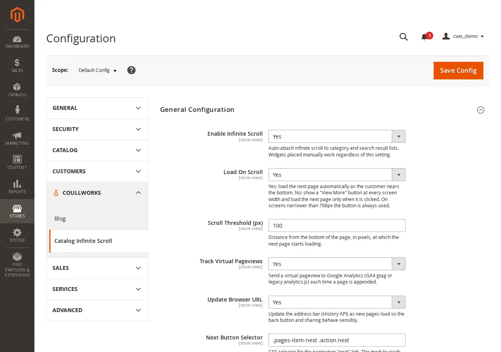
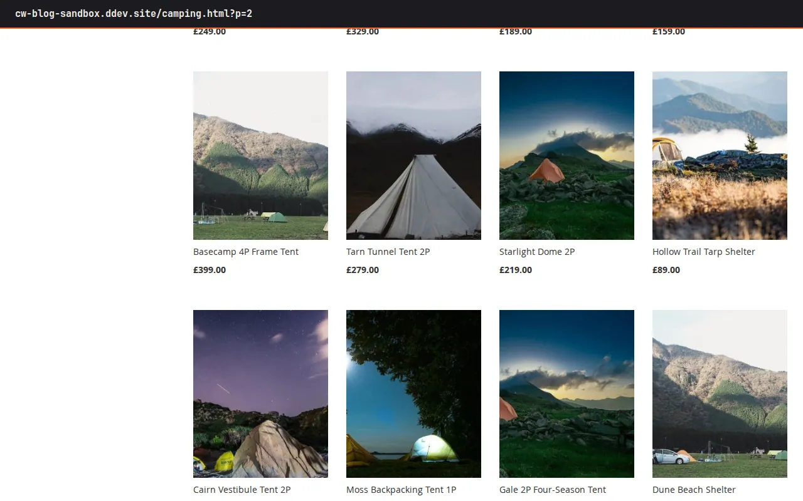

# Get started with Catalog Infinite Scroll in five minutes

This takes about five minutes on a store that already has the module [installed](install.md).

## 1. Open the settings

Go to **Stores, Configuration, CoullWorks, Catalog Infinite Scroll** and open **General Configuration**.

*Enable Infinite Scroll is the first field. It defaults to Yes, so a fresh install is already on.*

## 2. Check Enable is Yes and save

Leave every other field at its default. The defaults match Luma's category markup. If you changed anything, press **Save Config**, then **System, Cache Management** and refresh the invalidated Configuration and Page Cache types.

## 3. Test on a category

Open a category on the storefront that has more than one page of products and scroll down. The next page loads as you near the bottom.

*Pages two and four have loaded. The address bar names the last page loaded, here `?p=2`, then `?p=4`, so the URL is shareable.*

## 4. Try the other things worth checking

- **View More.** Set **Load On Scroll** to No, or open the category on a phone. A View More button replaces automatic loading. See [How it behaves](behaviour.md).
- **Search.** Search for a product with more than one page of results. It works the same way.
- **Analytics.** If you use GA4, each page loaded sends a virtual `page_view`. See the [reference](reference.md#analytics-and-virtual-pageviews).

## 5. Something not working?

If nothing loads, the usual cause is a theme whose markup differs from Luma. Open [Troubleshooting](troubleshooting.md) and set the three selectors.
