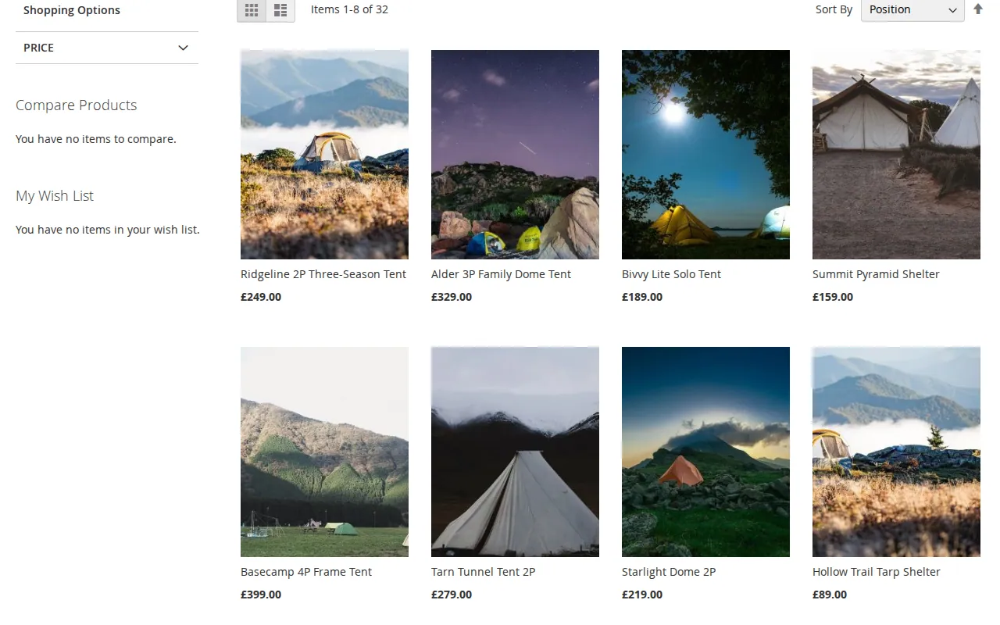
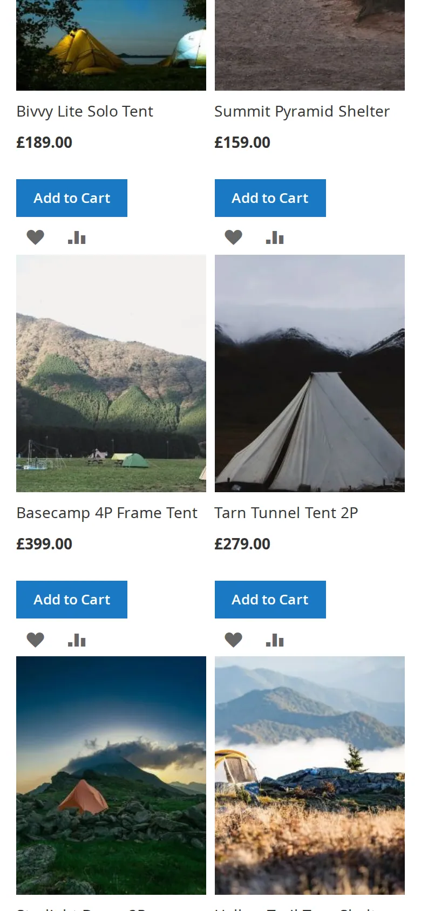
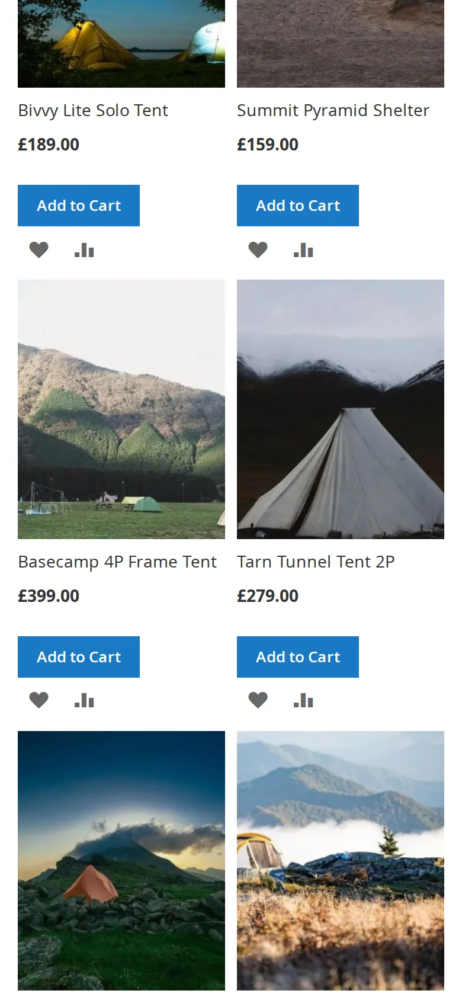
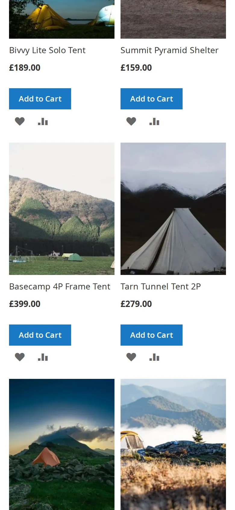

# Catalog Infinite Scroll layout modes

**Layout Mode** (Stores, Configuration, CoullWorks, Catalog Infinite Scroll) and the widget's **Layout Mode** parameter choose how appended products are arranged. The default keeps the theme's own grid.

## Default (theme grid)

Value 1. No layout library is loaded, nothing is hidden and the theme's grid is untouched, so Largest Contentful Paint is not affected. Use this unless you want a staggered layout.

*Default mode: the theme's four-column grid.*

*Default mode on a phone: two columns.*

## Masonry

Value 2. Loads the Masonry library, imagesLoaded and jQuery Bridget only when selected. The list is held invisible until its images are measured, then revealed, so items do not jump. Products sit in two columns below 768 px and three columns from 768 px, with a 10 px gutter. The library measures a column from an empty, hidden sizer element that the module adds to the list, so it does not depend on the theme's own margins. The grid is laid out again when an image finishes loading, when a page is appended, after Back restores the list, and when the window is resized.

*Masonry at 1280 px: three columns, no overlapping products.*

*Masonry on a phone: two columns.*

## Isotope

Value 3. The same loading, reveal, column widths and gutter as Masonry, using the Isotope library. It supports filtering and sorting in the library, which this module does not use. After a page is appended or the list is restored, Isotope re-arranges its items rather than reloading them.

*Isotope at 1280 px: three columns, no overlapping products.*

*Isotope on a phone: two columns.*

## Packery

Value 4. Uses the Packery library, with the same column widths, gutter and reveal as Masonry. Packery fills gaps left by items of different heights, so it suits lists where tiles are not all the same size.

*Packery at 1280 px: three columns, no overlapping products.*

*Packery on a phone: two columns.*

## Libraries and licences

Masonry, Isotope and Packery are self-hosted under the module's `js/vendor` folder. Infinite Scroll 3.0.6 and Isotope 3.0.6 are GPLv3 or commercial. See [the reference](reference.md#bundled-libraries).
