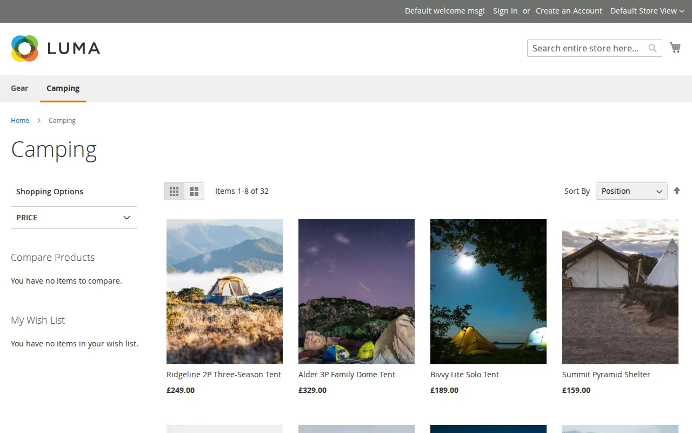

# Catalog Infinite Scroll for Magento 2 documentation

Catalog Infinite Scroll replaces numbered pagination with a continuous list. Shoppers keep scrolling and the next page of products loads in, with no full page reload. On narrow screens, or when you turn auto loading off, it shows a **View More** button instead of taking over the scroll.

It is free and open source under the MIT licence.

*The Camping category before any scrolling: eight products, and the module already attached.*

## Requirements

| Item | Supported |
|---|---|
| Magento | Open Source and Adobe Commerce 2.4.7, 2.4.8 and 2.4.9 |
| PHP | 8.2, 8.3, 8.4 and 8.5 |
| Theme | Luma, and custom themes with a jQuery and RequireJS storefront |
| Not supported | **Hyvä.** The module needs jQuery and RequireJS, which Hyvä does not use. Headless and PWA front ends are not supported either |

## Why it differs

- **It works on any list**, not just the category grid. A widget puts it on Page Builder blocks, CMS pages and static blocks, and one page can drive several lists.
- **It protects LCP.** The default mode never hides your products, and the masonry, isotope and packery libraries download only when you choose one of those layouts.
- **It calls nothing external.** Every library is self-hosted in the module: no third-party request, no CSP changes and nothing to break when a CDN does.

## Where it runs

On category and search result pages once enabled, and on any list you add the **Infinite Scroll (CoullWorks)** widget to. When a layered navigation filter replaces the product list without a page reload, the module detects the swap and starts again on the new list.

It reports a virtual page view to GA4 (`gtag`), or to legacy `analytics.js` where present, for each page it appends, so infinite scroll does not blank your page metrics.

## Where to go next

| You want to | Read |
|---|---|
| Add the module | [Install](install.md) |
| See it working in five minutes | [Get started](get-started.md) |
| Know what every admin field does | [Configure](configure.md) |
| Turn it off for one store view | [Per store view settings](store-views.md) |
| Put it on a CMS page or Page Builder list | [The widget](widget.md) |
| Understand scrolling, View More, the URL and Back | [How it behaves](behaviour.md) |
| Masonry, Isotope and Packery | [Layout modes](layout-modes.md) |
| Events, JS options, CSS hooks, accessibility | [Reference](reference.md) |
| Fix something | [Troubleshooting](troubleshooting.md) |
| Update | [Upgrade](upgrade.md) and the [changelog](changelog.md) |
