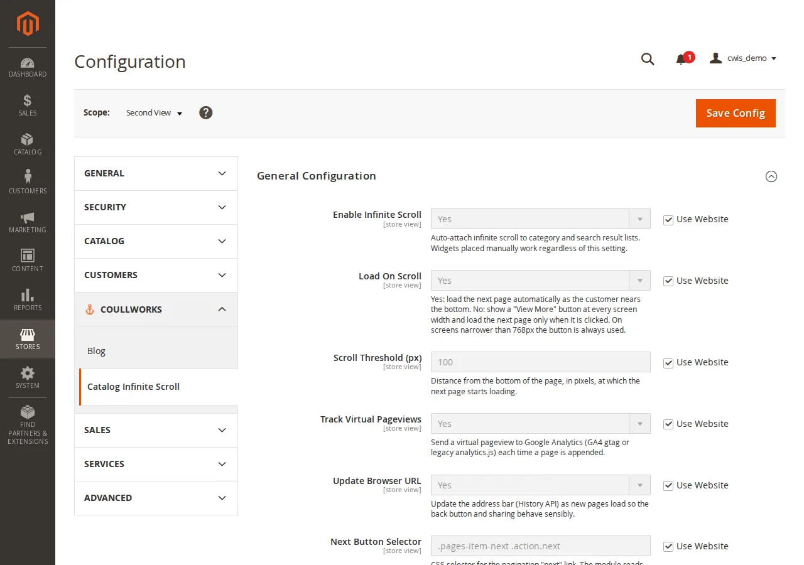
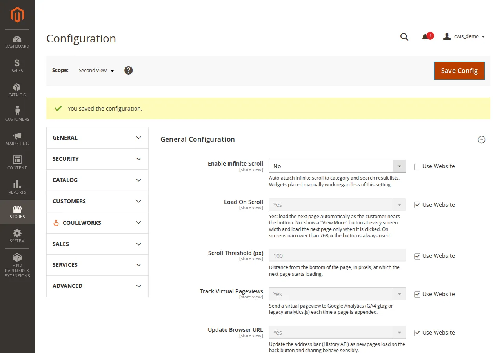
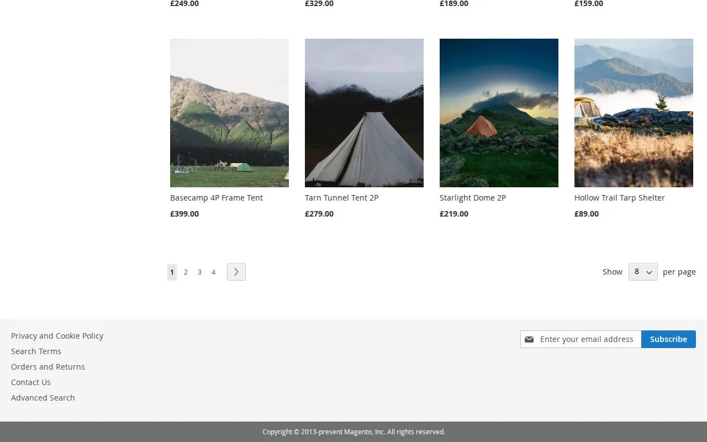

# Catalog Infinite Scroll settings per store view

Every setting can be set at **Default Config**, **website** and **store view** scope. A store view inherits from its website, and a website from the default, until you untick **Use Website** (or **Use Default**) and set its own value. This walkthrough turns infinite scroll off for one store view, called Second View.

## 1. Switch to the store view

Open **Stores, Configuration, CoullWorks, Catalog Infinite Scroll**. Use the **Scope** switcher at the top left and pick **Second View**.

*Every field shows the inherited value and has a **Use Website** tick box. Nothing can be edited until you untick it.*

## 2. Override the one field

Untick **Use Website** next to **Enable Infinite Scroll** and choose **No**.

*Only this field is overridden. The others stay greyed out and keep inheriting.*

## 3. Save

Press **Save Config**.

*Saved. The field now reads No at this store view, and the rest still follow the website.*

## 4. Check the storefront

Refresh the Configuration and Page Cache types, then open a category in that store view. The normal pager is back and nothing loads on scroll. Other store views are unchanged.

*The numbered pager, 1 2 3 4 and a next arrow, is back because Enable Infinite Scroll is No for this store view.*

## Good to know

- A widget on a CMS page still works in a store view where Enable is No, because the widget does not read that setting.
- The widget reads every other setting from the store view the page is shown in, unless the widget's own parameter is filled in.
