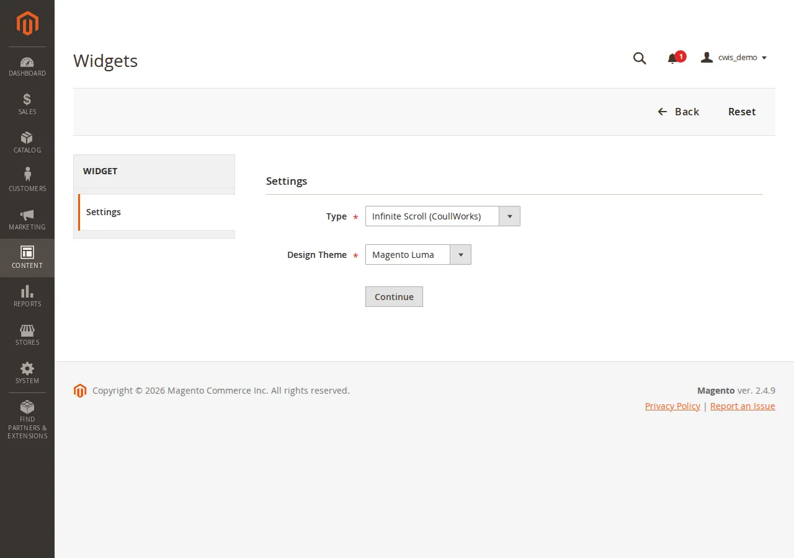
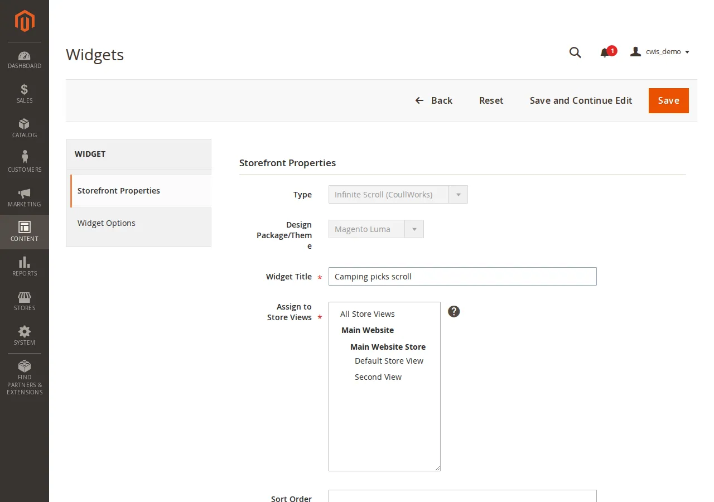
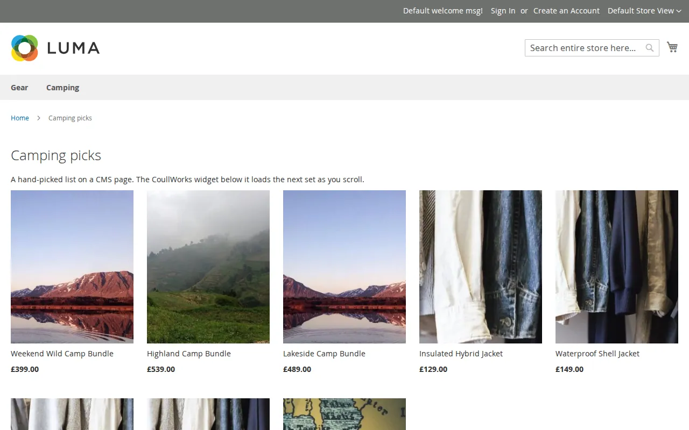
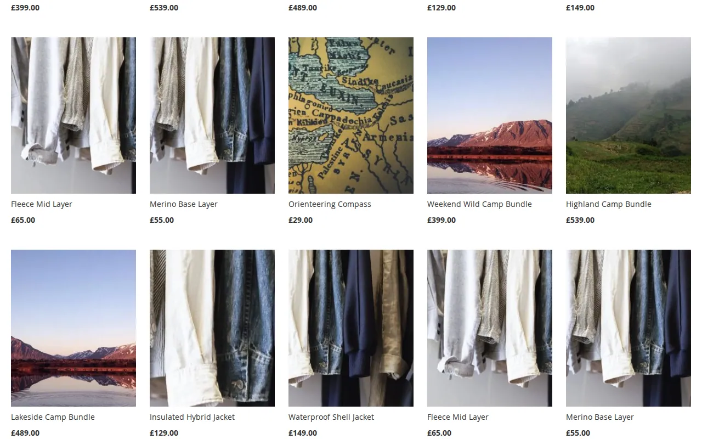
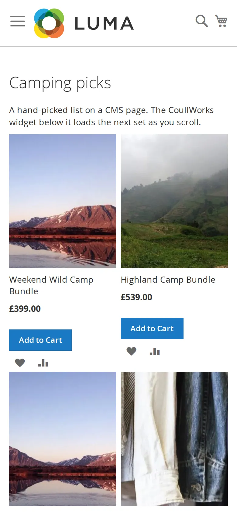
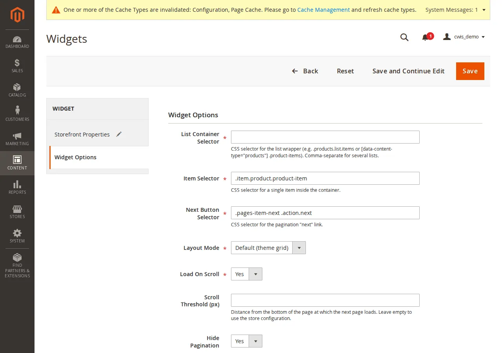

# The Infinite Scroll widget for Magento 2

The category and search pages are attached for you. For every other list, use the **Infinite Scroll (CoullWorks)** widget. It works whether or not Enable Infinite Scroll is on, and it needs a list that has a "next" link to follow (a product list with the toolbar pager, for example).

## Add the widget

**To add it as a standalone widget instance (layout widget):**

1. Go to **Content, Elements, Widgets** and press **Add Widget**.
2. Set **Type** to **Infinite Scroll (CoullWorks)** and **Design Theme** to your theme, then **Continue**.

*The widget type appears in the Type list. The theme decides which design the instance is for.*

3. On **Storefront Properties** give it a **Widget Title** and choose **Assign to Store Views**.

*The title is only for you. Pick the store views the widget should run on.*

4. Add a **Layout Update** to place it on a page, then fill in **Widget Options** below and **Save**.

**To insert it in a CMS page, static block or Page Builder:** in the editor press **Insert Widget**, choose **Infinite Scroll (CoullWorks)** and fill in the same options. In Page Builder add an **HTML Code** or **Products** area and use the editor's Insert Widget button; the module does not add a separate Page Builder content type. Layout XML works too, with a `<block class="CoullWorks\CatalogInfiniteScroll\Block\Widget\Scroll">` and the parameters as arguments.

The CMS page below runs the widget on a product list inside its content.

*The page before scrolling: the list and its own pager.*

*After scrolling, more products from the widget's list have been added in place.*

*At 390 px wide the widget uses the View More behaviour.*

## Widget options

*The Widget Options tab. Fields with a red star are required.*

Fields not filled in fall back to the store configuration where noted.

### List Container Selector

*List Container Selector is the first, required field.*

Required. A CSS selector for the wrapper that holds the items, for example `.products.list.items` or `[data-content-type="products"] .product-items`. Comma separate for several lists. Leave it empty in the form only if the store configuration already names the right list (the form still marks it required).

*Container selector with its help text and example selectors.*

### Item Selector

Required. One item inside the container. Preset: `.item.product.product-item`.

### Next Button Selector

Required. The pagination "next" link. Preset: `.pages-item-next .action.next`.

### Layout Mode

*Layout Mode is the fourth field, a drop-down.*

Required. Default (theme grid), Masonry, Isotope or Packery. See [Layout modes](layout-modes.md).

*Layout Mode set to Default (theme grid).*

### Load On Scroll

Required. Yes loads on scroll, No uses the View More button. A stored No overrides the store configuration.

### Hide Pagination

Optional. Yes hides the original pager. 

### Pagination Selector

Optional. The pager to hide. Preset `.pages`, which differs from the store configuration default, so check it matches your list.

### Show End Status

Optional. The loading animation and end message. See the pending note on [End Status](configure.md#show-end-status).

### End Status Text

Optional. Preset text is "No more items" (the store configuration default is "No more products").

### Scroll Threshold, Track Virtual Pageviews, Update Browser URL, Debug Logging

Since 2.1.0 the widget has its own parameters for these four. Leave them empty, or on **Use store setting**, and the widget follows the store configuration. In 2.0.x these four were not widget parameters and widgets always used the store configuration.

*Scroll Threshold (px) is empty, so the store configuration value is used.*
